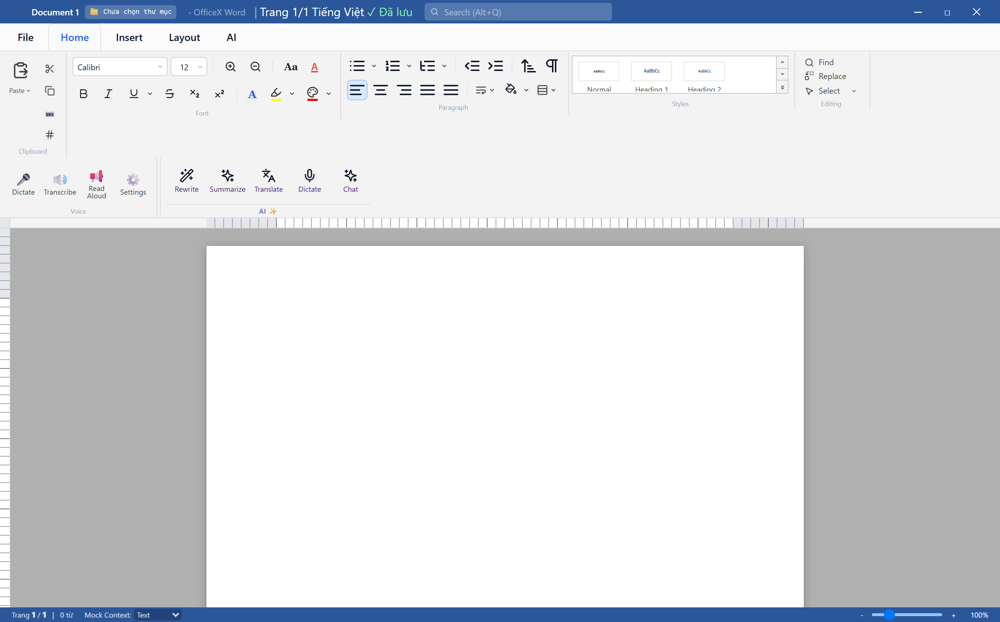

<div align="center">

# 🏢 OfficeX Suite

**Bộ ứng dụng văn phòng hiện đại, hiệu năng cao tích hợp AI (Word, Excel, PowerPoint, Launcher)**

[](https://github.com/taductoi1596-stack/OfficeX)
[](https://electronjs.org/)
[](https://www.typescriptlang.org/)
[](https://react.dev/)
[](https://vitejs.dev/)
[](https://turbo.build/)

---

</div>

## 📖 Giới thiệu (Overview)

**OfficeX Suite** là bộ ứng dụng văn phòng thế hệ mới dành cho máy tính (Desktop App), được xây dựng trên kiến trúc **Monorepo** với TypeScript, React và Electron. Dự án cung cấp đầy đủ các công cụ soạn thảo văn bản, bảng tính, trình chiếu và trợ lý trí tuệ nhân tạo (AI Assistant) với giao diện người dùng thân thiện, trực quan và tốc độ xử lý vượt trội.

---

## 📸 Giao diện ứng dụng (Application Screenshots)

### 1. Workplace Launcher (Bảng điều khiển trung tâm)
> Giao diện quản lý toàn diện các ứng dụng trong bộ Suite, tài liệu mở gần đây và trạng thái hệ thống.


---

### 2. Workplace Excel (Ứng dụng Bảng tính & Dịch thuật AI)
> Xử lý dữ liệu bảng biểu, tính toán công thức, tương thích định dạng `.xlsx` và `.xls` (BIFF8 OLE2), tích hợp tính năng **Dịch thuật AI**.


---

### 3. Workplace Word (Ứng dụng Soạn thảo văn bản)
> Trình soạn thảo văn bản đa năng hỗ trợ `.docx`, định dạng văn bản nâng cao, bảng biểu và thanh công cụ Ribbon chuẩn mực.



---

### 4. Workplace PowerPoint (Ứng dụng Trình chiếu)
> Thiết kế bài thuyết trình đa phương tiện với hệ thống slide deck mượt mà và trực quan.


---

## ✨ Tính năng nổi bật (Key Features)

### 📊 Workplace Excel
- **Tương thích định dạng đa dạng**:
  - Hỗ trợ định dạng hiện đại **`.xlsx` (OpenXML)** với đầy đủ kiểu dáng và cấu trúc trang tính.
  - Hỗ trợ định dạng cổ điển **`.xls` (Excel 97-2003 BIFF8 / OLE2 Compound Document)**: đọc chính xác các ô trộn (Merged Cells), màu nền ô (Yellow response cells), độ rộng cột (`COLINFO`), bảng chuỗi Unicode (`SST`).
  - Hỗ trợ tệp **`.csv`**, **`.tsv`** với khả năng tự động nhận diện dấu phân cách và chuẩn RFC 4180.
- **Dịch thuật AI thông minh (AI Translation)**:
  - Dịch trực tiếp ô đang chọn (`Ctrl+Shift+T`).
  - Dịch và tự động chèn kết quả vào cột kế bên.
  - Dịch hàng loạt toàn bộ trang tính (Batch Sheet Translation) với thanh tiến trình trực quan.
- **Bộ máy tính toán mạnh mẽ**: Hơn 100+ hàm Excel chuẩn (Toán học, Thống kê, Tài chính, Logic, Tìm kiếm...).

### 📝 Workplace Word
- Soạn thảo tài liệu chuẩn Microsoft Word (`.docx`, `.doc`, `.rtf`, `.txt`).
- Hệ thống Ribbon thanh công cụ chuẩn mực: Trang đầu (Home), Chèn (Insert), Bố trí (Layout), Xem (View).
- Định dạng đoạn văn, kiểu dáng văn bản, căn lề, danh sách chỉ mục và bảng biểu.

### 📽️ Workplace PowerPoint
- Quản lý danh sách trang trình chiếu (Slide Deck), kéo thả và sắp xếp slide.
- Chèn khối hình (Shapes), biểu đồ, hộp văn bản và hiệu ứng chuyển động.

### 🚀 Workplace Launcher & Platform Services
- **Khởi động lũy tiến (Progressive Startup)**: Tối ưu hóa thời gian mở ứng dụng dưới 1 giây.
- **Khôi phục sự cố tự động (Crash Recovery)**: Tự động lưu bản chụp phiên làm việc để khôi phục tài liệu khi xảy ra sự cố đột ngột.
- **Tích hợp sâu vào Windows**: Hỗ trợ mở đúp chuột mở file (`File Associations`), đăng ký menu ngữ cảnh chuột phải và Control Panel Programs & Features.

---

## 🛠️ Công nghệ sử dụng (Tech Stack)

| Thành phần | Công nghệ |
| :--- | :--- |
| **Monorepo Tool** | [Turborepo](https://turbo.build/) + [pnpm](https://pnpm.io/) Workspaces |
| **Desktop Runtime** | [Electron 30](https://www.electronjs.org/) + Node.js 20+ |
| **Frontend Framework** | [React 18](https://react.dev/) + [TypeScript](https://www.typescriptlang.org/) |
| **Bundler & Build** | [Vite 5](https://vitejs.dev/) + ESBuild |
| **Styling** | [Tailwind CSS](https://tailwindcss.com/) + Lucide Icons |
| **Packaging** | [electron-builder](https://www.electron.build/) (NSIS Windows Installer) |
| **Testing** | [Vitest](https://vitest.dev/) + Puppeteer |

---

## 📁 Cấu trúc dự án (Monorepo Structure)

```text
OfficeX/
├── apps/
│   ├── desktop/          # Electron Main Process & Preload Bridge
│   ├── launcher/         # Giao diện Workplace Launcher Hub
│   ├── word/             # Giao diện soạn thảo Workplace Word
│   ├── excel/            # Giao diện bảng tính Workplace Excel
│   ├── powerpoint/       # Giao diện trình chiếu Workplace PowerPoint
│   ├── ai/               # Giao diện trợ lý AI Assistant
│   ├── settings/         # Cài đặt cấu hình Suite
│   └── updater/          # Module cập nhật phần mềm tự động
├── packages/
│   ├── spreadsheet-core/ # Engine dữ liệu bảng tính, Workbook & Sheet
│   ├── formula-engine/   # Bộ phân tích cú pháp & tính toán công thức
│   ├── word-commands/    # Hệ thống command & shortcuts cho Word
│   ├── desktop-runtime/  # Shared data store & DI container
│   ├── window-manager/   # Quản lý đa cửa sổ Electron
│   ├── recovery/         # Cơ chế khôi phục trạng thái Crash Recovery
│   └── platform-*/       # Tích hợp Clipboard, Dialogs, Notifications
├── resources/            # Biểu tượng (Icons), mẫu template tài liệu
└── scripts/              # Script đóng gói và kiểm thử tự động
```

---

## 🚀 Hướng dẫn cài đặt & Chạy ứng dụng

### 1. Cài đặt bản đóng gói (Dành cho người dùng)
Bạn có thể tải và chạy trực tiếp bộ cài đặt Windows:
- File cài đặt: `Workplace Launcher Setup 1.0.0.exe` (Hỗ trợ cài đặt tự động và tạo shortcut Desktop).

### 2. Phát triển từ mã nguồn (Dành cho lập trình viên)

**Yêu cầu hệ thống:**
- Node.js >= 20.0.0
- pnpm >= 9.0.0

**Các bước cài đặt:**
```bash
# 1. Clone repository về máy
git clone https://github.com/taductoi1596-stack/OfficeX.git
cd OfficeX

# 2. Cài đặt toàn bộ dependencies
pnpm install

# 3. Chạy ở chế độ phát triển (Development)
pnpm run dev

# 4. Build toàn bộ dự án
pnpm run build

# 5. Đóng gói ứng dụng thành file .exe cài đặt
pnpm run package
```

---

## 📄 Bản quyền (License)

Copyright © 2026 **Workplace Suite**. Phát triển và phân phối bởi team OfficeX.

